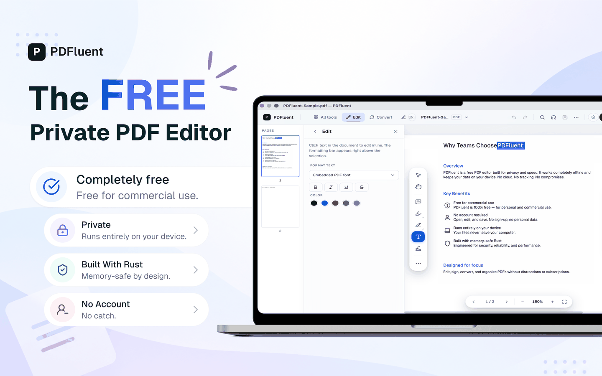

  

<h1 align="center">PDFluent</h1>

<strong>The free PDF editor. Free for everyone, including commercial use. No account, works offline.</strong>

  
  
  
  

  <a href="https://pdfluent.com/download"><b>Download for macOS and Windows</b></a> ·
  <a href="https://apps.microsoft.com/detail/xpdbxj6xrlfqk2">Microsoft Store</a> ·
  <a href="LICENSE.md">Source-available license</a> ·
  <a href="#built-on-the-pdfluent-sdk">PDFluent SDK</a>

  

PDFluent is a free, source-available PDF editor for macOS and Windows. It edits, converts, redacts, and signs PDFs entirely on your device, with no account, no upload, and no subscription.

---

## What it does

<table>
<tr>
<td width="33%" valign="top"><b>Edit text</b> Edit text directly in a PDF, not just annotate over it.</td>
<td width="33%" valign="top"><b>Convert</b> Convert to and from Word, Excel, and PowerPoint.</td>
<td width="33%" valign="top"><b>Fill forms</b> Fill and flatten AcroForms (text, checkbox, radio, combo/list, comb).</td>
</tr>
<tr>
<td valign="top"><b>Annotate</b> Highlight, underline, strikeout, comments, shapes, freehand.</td>
<td valign="top"><b>Manage pages</b> Merge, split, reorder, rotate, compress, and watermark pages.</td>
<td valign="top"><b>Sign</b> Digital signatures (PAdES / PKCS#12).</td>
</tr>
<tr>
<td valign="top"><b>OCR</b> OCR for scanned documents.</td>
<td valign="top"><b>PDF/A</b> PDF/A conversion.</td>
<td valign="top"><b>XFA forms</b> View and flatten XFA forms (interactive XFA fill is experimental).</td>
</tr>
</table>

---

## Privacy

Most PDF editors either cost money every month or run your documents through someone else's server. PDFluent does neither. Everything runs locally: opening, editing, and converting a PDF never leaves your machine unless you choose to send it somewhere. PDFluent doesn't upload your documents anywhere, and optional diagnostics are opt-in.

## Why PDFluent

The app is built with [Tauri v2](https://tauri.app/) (Rust + React/TypeScript) on top of the PDFluent SDK, a pure-Rust PDF engine with no Pdfium, Poppler, MuPDF, or other C/C++ dependencies.

## Status

Available on macOS and Windows. Complete for the non-XFA feature set: viewing, AcroForm filling (text, checkbox, radio, combo/list, comb), annotations, page management, merge/split, digital signatures, conversions, and OCR. XFA documents can be viewed and converted or flattened to a standard PDF. Dynamic XFA interactive fill is still experimental and not part of this release.

## How it compares

| | PDFluent | Adobe Acrobat | Browser-based tools |
|---|---|---|---|
| Price | Free | Subscription | Often free, ad-supported |
| Runs offline | Yes | Mostly | No, files go through a server |
| Account required | No | Yes | Usually no |
| Source | Available on GitHub | Closed | Closed |
| Platforms | macOS, Windows | macOS, Windows, web | Any browser |

A longer, regularly updated comparison lives at [pdfluent.com/vs-adobe-acrobat](https://pdfluent.com/vs-adobe-acrobat).

## Built on the PDFluent SDK

The editor's PDF engine, the [PDFluent SDK](https://pdfluent.com/sdk), is a separate product with bindings for six languages. It is dual-licensed: AGPL-3.0, or a commercial licence if the copyleft does not work for you. If you're building your own PDF tooling rather than using the editor, the SDK is what you want:

| Language | Package | Install |
|---|---|---|
| Rust | [`pdfluent`](https://crates.io/crates/pdfluent) on crates.io | `cargo add pdfluent` |
| Python | [`pdfluent`](https://pypi.org/project/pdfluent) on PyPI | `pip install pdfluent` |
| Node.js | [`@pdfluent/node`](https://www.npmjs.com/package/@pdfluent/node) on npm | `npm i @pdfluent/node` |
| Browser / WASM | [`@pdfluent/sdk-wasm`](https://www.npmjs.com/package/@pdfluent/sdk-wasm) on npm | `npm i @pdfluent/sdk-wasm` |
| .NET | [`pdfluent`](https://www.nuget.org/packages/pdfluent) on NuGet | `dotnet add package pdfluent` |
| Java | [`com.pdfluent:pdfluent`](https://central.sonatype.com/artifact/com.pdfluent/pdfluent) on Maven Central | see Maven Central for the dependency snippet |

Full SDK documentation: [pdfluent.com/docs](https://pdfluent.com/docs). SDK licensing and pricing: [pdfluent.com/sdk/pricing](https://pdfluent.com/sdk/pricing). SDK source: [github.com/pdfluent/pdfluent-sdk](https://github.com/pdfluent/pdfluent-sdk).

The editor itself doesn't need any of this. It ships with the engine built in and never checks a license.

## Architecture

See [docs/ARCHITECTURE.md](docs/ARCHITECTURE.md) for how the frontend, Tauri backend, and SDK fit together, plus the Tauri command surface.

## Build from source and contributing

Build from source and contributing

 

See [CONTRIBUTING.md](CONTRIBUTING.md) for how to set up a dev environment, code style, and how to submit changes. Note that this repository doesn't build standalone: the SDK it depends on is a separate, closed workspace.

## FAQ

**Is PDFluent free?**
Yes, for the desktop editor, including commercial and business use. No license key, no trial period, no feature gates.

**Is it open source?**
It's source-available, not open source in the OSI sense. The code here is public under the license in [LICENSE.md](LICENSE.md), which lets you read, build, and modify the editor but doesn't grant a right to extract or redistribute the embedded PDF engine outside the app. The [PDFluent SDK](https://pdfluent.com/sdk) is a different product with its own licence: AGPL-3.0, or a commercial licence at your option.

**Does anything leave my device?**
No, by default. PDFluent doesn't upload your documents anywhere. Optional diagnostics are opt-in.

**What's built with?**
Tauri v2, Rust, React, and TypeScript on the frontend/shell side; the PDFluent SDK for everything PDF-related.

**How does this compare to Adobe Acrobat?**
See the table above, or the longer writeup at [pdfluent.com/vs-adobe-acrobat](https://pdfluent.com/vs-adobe-acrobat).

## What's built

- [x] PDF viewing (open, render, navigate pages)
- [x] Zoom controls (Cmd +/-, reset)
- [x] Page thumbnails in sidebar
- [x] Keyboard navigation (arrows, PageUp/Down, Home/End)
- [x] Manipulation (merge, split, rotate, delete/reorder pages, compress, watermark)
- [x] Annotations (highlight, underline, strikeout, comment, shapes, freehand)
- [x] Form filling (AcroForms: text, checkbox, radio, combo/list, comb, multi-select, link trust)
- [x] Digital signatures (PAdES / PKCS#12)
- [x] Conversions (DOCX/XLSX/PPTX, PDF/A) and OCR
- [x] XFA: view + convert/flatten to standard PDF (interactive XFA fill is experimental, not shipped)
- [ ] Storage integration (BYOS, managed storage)

## License

PDFluent is source-available, proprietary software, free to use including for commercial and business use. It isn't open source: extracting or embedding its components outside the application requires a separate license.

Full End-User License Agreement in [LICENSE.md](LICENSE.md) (summary in [LICENSE](LICENSE)), also at [pdfluent.com/license](https://pdfluent.com/license). SDK licensing at [pdfluent.com/sdk/pricing](https://pdfluent.com/sdk/pricing).

Third-party open-source components bundled with PDFluent remain under their own licenses; see [THIRD_PARTY.md](THIRD_PARTY.md) and [THIRD_PARTY_ATTRIBUTIONS.md](THIRD_PARTY_ATTRIBUTIONS.md) (also in-app under Help → Open Source Notices).

## Links

- [pdfluent.com](https://pdfluent.com): homepage
- [pdfluent.com/download](https://pdfluent.com/download): get the app
- [pdfluent.com/docs](https://pdfluent.com/docs): SDK documentation
- [pdfluent.com/support](https://pdfluent.com/support): support
- [github.com/pdfluent/examples](https://github.com/pdfluent/examples): SDK code examples
